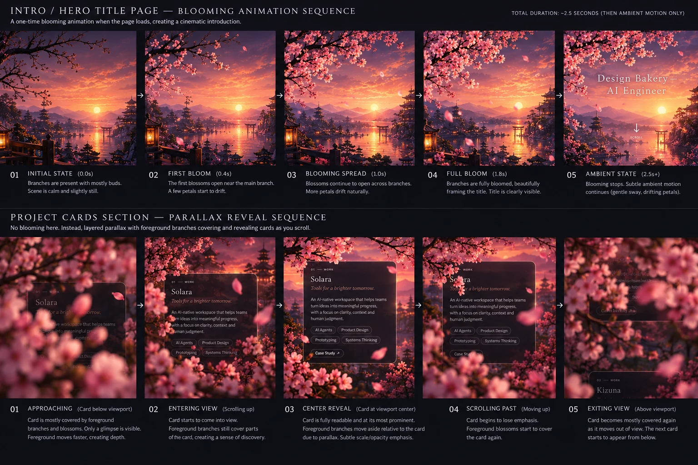
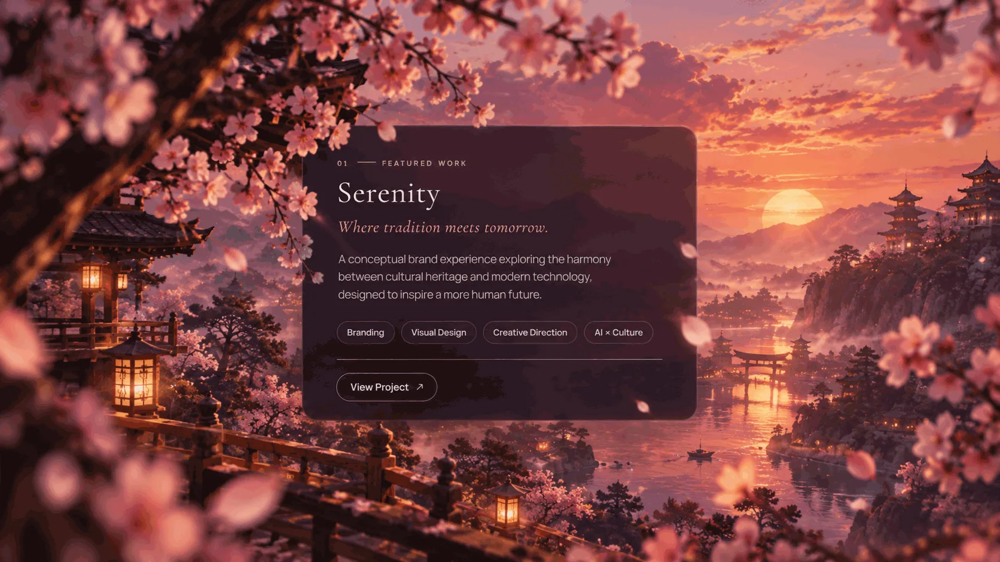

# Design direction — `/version-2`: intro bloom + project-card parallax

| Field | Value |
|-------|-------|
| **Document date** | 2026-10-12 |
| **Created** | 2026-10-12 |
| **Last updated** | 2026-10-12 |
| **Repo** | `Pukujan/design-bakery` |
| **Code** | `frontend/version-2-app/src/components/journey/` — `Arrival.tsx`, `Work.tsx`, `SakuraTree.tsx`, `ProjectMoment.tsx` |
| **Task** | [TASK-DB-0088](../../../tasks/TASK-DB-0088-bloom-and-card-parallax.md) |

## Why this document exists

The owner carried this direction in session and it was **never written down durably** — no issue, no
task file, no dev log. It survived only in conversation, which is exactly how it got lost. This file
and the task file beside it are the durable record, and the reference images are committed next to
this document so the direction cannot evaporate again.

Owner's words, verbatim:

> *"so instead of the horrible image 6 sakura tree design we have right now the plan was to change
> it to more dynamic sakura tree parallax of other images as u can see that was the idea but
> apparently it was never written down durably in issue log and repo"*

> *"here like this, for intro and the project cards, everythign else can stay same"* — introducing the
> storyboard in `ref-04`.

## Mission

Two sequences, and nothing else in the journey changes:

1. **Intro / hero** — a one-time **blooming animation** on load (~2.5 s), then ambient motion only.
2. **Project cards** — **layered parallax** where blurred foreground branches cover and reveal each
   card as it passes through the viewport. **No blooming here.**

The procedural silhouette sakura tree (`SakuraTree.tsx`) is replaced by photographic layers in both.

## Read first

1. `AGENTS.md` (repo rules), `HANDOFF.md` (setup + conventions).
2. `checkpoints/CURRENT.md` — current state; the `/version-2` entry.
3. [TASK-DB-0088](../../../tasks/TASK-DB-0088-bloom-and-card-parallax.md) — the task this belongs to.
4. [TASK-DB-0087](../../../tasks/TASK-DB-0087-journey-scroll-and-sword.md) — the scroll/clock work
   this must not undo. **The reveal registry and the single eased clock are load-bearing here.**
5. `docs/DRIVING_ABA.md` — the plates are image-generation calls made through ABA's runner, not
   hand-drawn art.

---

# The authoritative storyboard

`ref-04-storyboard-bloom-and-card-parallax.webp` is the spec. Both sequences below are transcribed
from it verbatim.

## Sequence 1 — Intro / hero title page: blooming animation

> *"A one-time blooming animation when the page loads, creating a cinematic introduction.
> TOTAL DURATION: ~2.5 SECONDS (THEN AMBIENT MOTION ONLY)"*

| # | State | Time | Spec |
|---|-------|------|------|
| 01 | **INITIAL STATE** | 0.0s | Branches are present with mostly buds. Scene is calm and slightly still. |
| 02 | **FIRST BLOOM** | 0.4s | The first blossoms open near the main branch. A few petals start to drift. |
| 03 | **BLOOMING SPREAD** | 1.0s | Blossoms continue to open across branches. More petals drift naturally. |
| 04 | **FULL BLOOM** | 1.8s | Branches are fully bloomed, beautifully framing the title. Title is clearly visible. |
| 05 | **AMBIENT STATE** | 2.5s+ | Blooming stops. Subtle ambient motion continues (gentle sway, drifting petals). |

The title in frame 04/05 is the existing arrival line — `Design Bakery — AI Engineer` — with a
`SCROLL` cue and a down-arrow beneath it.

## Sequence 2 — Project cards: parallax reveal

> *"No blooming here. Instead, layered parallax with foreground branches covering and revealing cards
> as you scroll."*

| # | State | Card position | Spec |
|---|-------|---------------|------|
| 01 | **APPROACHING** | Card below viewport | Card is mostly covered by foreground branches and blossoms. Only a glimpse is visible. **Foreground moves faster**, creating depth. |
| 02 | **ENTERING VIEW** | Scrolling up | Card starts to come into view. Foreground branches still cover parts of the card, creating a sense of discovery. |
| 03 | **CENTER REVEAL** | Card at viewport center | Card is fully readable and at its most prominent. **Foreground branches move aside relative to the card due to parallax.** Subtle scale/opacity emphasis. |
| 04 | **SCROLLING PAST** | Moving up | Card begins to lose emphasis. Foreground blossoms start to cover the card again. |
| 05 | **EXITING VIEW** | Above viewport | Card becomes mostly covered again as it moves out of view. **The next card starts to appear from below.** |

---

# Supporting references — the static composition

## `before-00-current-procedural-tree.webp` — what we have now (the thing to replace)

The muddy dark translucent mass through the middle of the frame **is** the sakura tree. It is
hand-authored SVG (`SakuraTree.tsx`, 331 lines): a canopy mass, four lobes, six skirt strokes, a trunk
and two boughs, plus a generated root system (one spine, eleven tendrils, twenty-two hairs) revealed by
`stroke-dashoffset`. At full opacity it reads as a smudge rather than a tree, and it competes with the
project cards instead of framing them.

## `ref-01` / `ref-02` — the card design

## `ref-03` — the column, two cards, foreground crossing in front

# What the references establish

**The scene is photographic and layered.** Sunset sky with heavy cloud, the sun low over water, a
misty mountain range, pagodas on a cliff at the right, a lakeside village of lit lanterns, a red torii
standing in the shallows, a small boat. Nothing in it is procedurally drawn.

**The depth comes from the foreground.** Out-of-focus sakura branches and blossom masses cross the
**top, left, right and bottom** edges of the frame, heavily blurred, and they pass **in front of** the
cards (clearest in `ref-03`, where blossom crosses the second card, and in storyboard frames 01/02/04/05
of sequence 2). That foreground plane is what makes the scene read as deep — and it is the plane that
moves fastest on scroll.

**The cards are translucent glass, not opaque panels.** The scene reads through them; they are dark,
rounded, generously padded, with a hairline divider above the actions.

**Card anatomy** (identical in all references):

- eyebrow — `01 —— WORK` (storyboard frames) / `01 —— FEATURED WORK` (`ref-01`)
- title in the display serif — `Solara`, `Serenity`, `Kizuna`
- italic tagline — *Tools for a brighter tomorrow.*, *Where tradition meets tomorrow.*
- one body paragraph
- tag pills, wrapping
- a hairline rule
- action pills — `Case Study ↗` in the storyboard; a secondary `Watch Film` with a play glyph in `ref-02`

**Cards alternate sides** down the column, which the current `ProjectMoment` `side` already does.

# Settled by this direction

- **The tree is replaced**, not overlaid — both sequences are photographic layers plus blurred
  foreground branches. The procedural canopy, trunk, boughs and root system go.
- **The references are the art to match** — the specific sunsets, pagodas, torii, lanterns and
  lakeside village.
- **All eleven projects stay in one column**, restyled as the translucent cards, with the parallax
  reveal mechanic. No featured/rest split.
- **Everything else in the journey stays** — the cut/seam, the washi tear, the night scene, About,
  nav, contact.

# Technical realities (not open questions — implementation facts)

1. **Parallax needs the scene split into layers.** Every reference is a single flat image; you cannot
   translate part of one. The Work section needs at minimum three plates — background (sky, mountains,
   lake, sun), midground (torii, lanterns, pagodas, boat), foreground (blurred blossom crossing the
   frame edges) — with the foreground moving fastest.
2. **A bloom cannot be animated inside one photograph.** Sequence 1 needs the intro scene at two or
   three bloom stages — buds, partial, full — cross-faded (and scaled) over 2.5 s. The drifting petals
   are a particle layer; the existing `ParticleField.tsx` is the natural home.
3. **The parallax must ride the existing eased clock** (`journey.scrollY` / `--p` in
   `useJourneyScroll.ts`). A second scroll listener would reintroduce exactly the two-clocks defect
   TASK-DB-0087 removed.
4. **The card's "subtle scale/opacity emphasis" at centre** is a per-card scroll-driven curve keyed to
   the card's own position in the viewport — new, and it has to work with the reveal registry, not
   against it.
5. **Reduced motion needs a full static compose** — today it draws every root and lights every node by
   computed style; the replacement needs an equivalent (bloom completed, parallax frozen at a
   composed frame).
6. **Layout must stay read on resize only.** `SakuraTree.tsx` is careful never to read layout inside
   the scroll frame; that discipline must survive the rewrite.

# Constraints

- **Do not undo TASK-DB-0087** — one eased clock; the reveal registry sweeps each frame's segment.
- **The content contract is frozen** — 11 projects, 5 roles, brand, About; `src/data/content.ts` is
  verbatim and nothing may be invented or dropped.
- **Plates are generated through ABA's runner in iterate mode** (`docs/DRIVING_ABA.md`), as
  TASK-DB-0087 was — not hand-drawn into the app.
- **The arrival line stays** — `Design Bakery — AI Engineer`, framed by the bloom.
