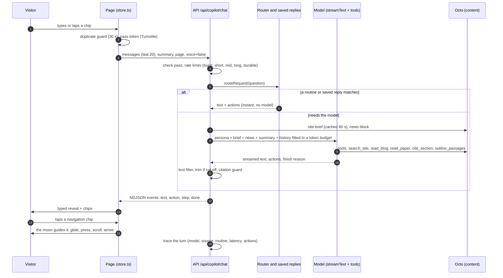
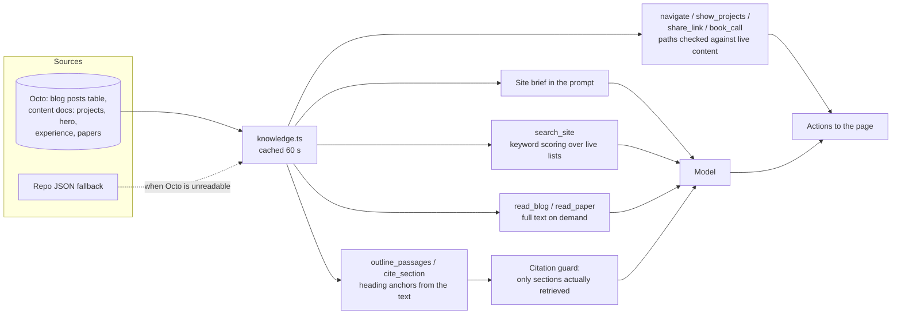
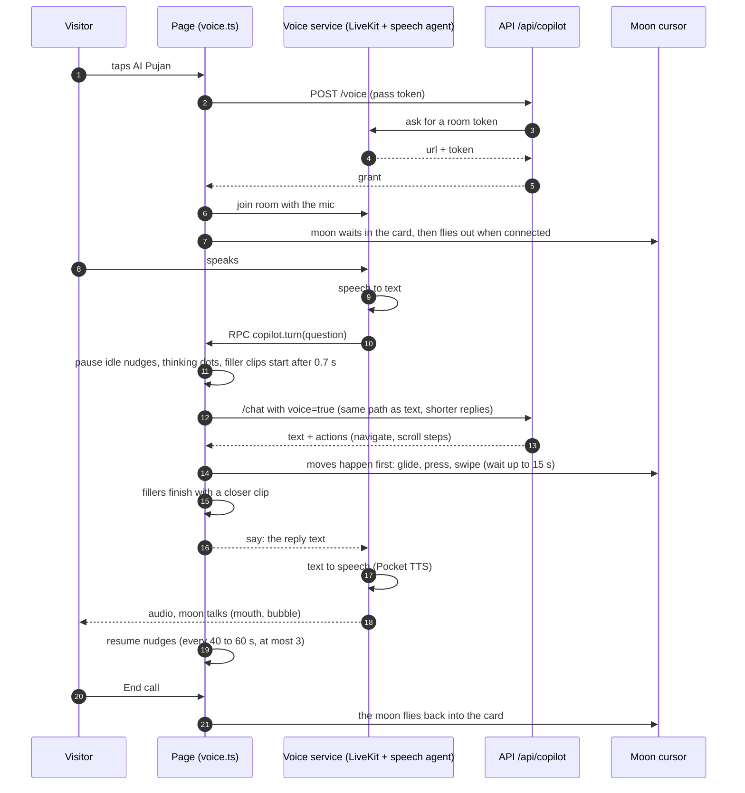
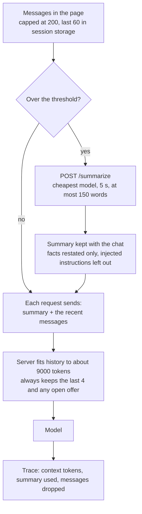
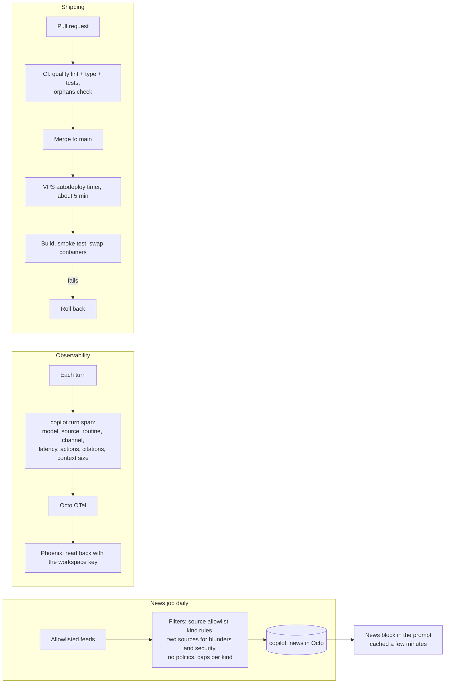

# How the copilot works end to end

Diagrams of how AI Pujan, the site copilot, works today (as of PRs up to #196). They show the code paths, not a promise: see `backend/src/copilot/`, `frontend/src/app/modules/copilot/` and `deploy/gravebuster/`.

## 1. The whole system

```mermaid
flowchart LR
  V([Visitor's browser]) -->|HTTPS| CF[Cloudflare tunnel]
  CF --> CD[Caddy on the VPS]
  CD -->|static site| WEB[design-bakery-web]
  CD -->|/api/*| API[design-bakery-api<br/>Express]
  V -. voice: WebRTC .-> LK[Voice service<br/>copilot.design-bakery.com<br/>LiveKit room + speech agent]
  LK -. TTS .-> MAC[Pocket TTS on the MacBook Pro]
  LK -. copilot.turn RPC into the page .-> V
  API --> OCTO[(Octo workspace<br/>Postgres: blogs, content docs,<br/>copilot_news)]
  API --> PROV[Model providers by health:<br/>DeepSeek via InferHub, Qwen,<br/>WorkBuddy, OpenRouter]
  API --> PHX[Traces: OTel via Octo to Phoenix]
  NEWS[Daily news job] --> OCTO
  FEEDS[Allowlisted feeds<br/>RSS, GitHub, arXiv, HN] --> NEWS
```

## 2. One text chat turn



## 3. Who answers: the routing decision

```mermaid
flowchart TD
  Q([Question]) --> F{First turn?}
  F -- no --> REF{Refers back to the conversation?<br/>"we talked about", "I said"}
  REF -- yes --> MODEL
  REF -- no --> RT
  F -- yes --> RT{A routine matches?<br/>open, latest, tech, role, offer}
  RT -- yes --> RUN[Run the routine:<br/>instant text + moon actions]
  RT -- no --> INT{A saved intent matches?<br/>greeting, small talk, thanks,<br/>injection joke, project about,<br/>service areas, tour, contact, book}
  INT -- yes --> SAVED[Saved reply, several wordings<br/>never the same as last time]
  INT -- no --> MODEL[Model path with tools]
  RUN --> OUT([Reply])
  SAVED --> OUT
  MODEL --> OUT
```

## 4. Content, retrieval and tools (what "RAG" is here)



There is no vector index yet. Retrieval is the brief plus keyword search and reading a record in full.

## 5. One live voice turn



## 6. Memory in a long chat



## 7. News, traces and how changes ship


